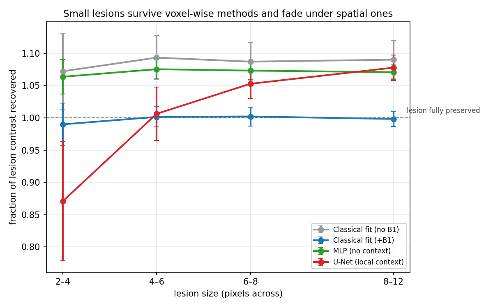
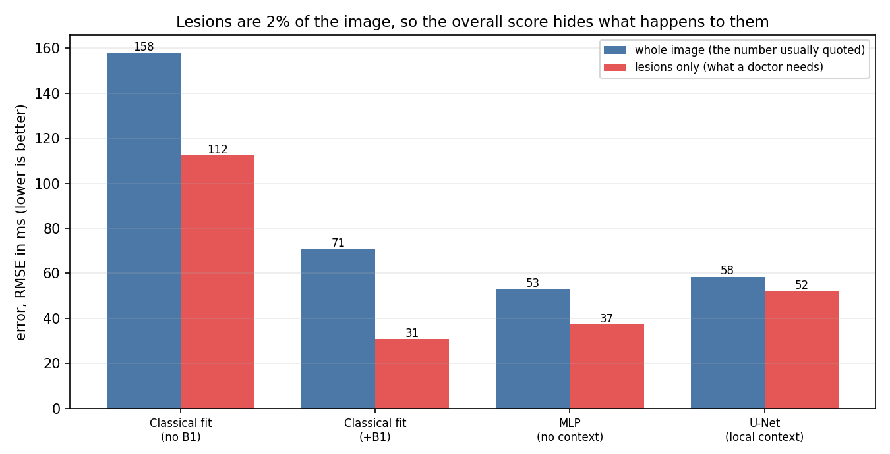
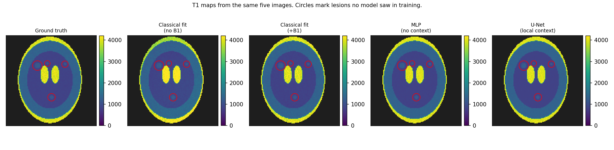

# qmri-t1-benchmark

Do convolutional networks estimate T1 more accurately than voxel-wise
fitting — or do they just smooth away the lesions we are looking for?

## The question

Quantitative MRI aims to measure a physical tissue property (here T1, the
spin-lattice relaxation time) rather than produce a picture whose brightness
is arbitrary. The standard estimator fits a physical signal model to a handful
of images **one voxel at a time, independently**. A CNN can use spatial
context instead, which should help — but a network trained on normal anatomy
has every incentive to smooth a 3-voxel lesion out of existence, and it will
still report a lower overall error when it does.

This repository measures that trade-off on simulated data, where the true T1
is known exactly.

## The answer, in two figures



Every method that works **one voxel at a time** returns a flat line: a tiny
lesion survives as well as a large one, because a method with no neighbours
has nothing to blur it with. The U-Net bends. It recovers lesions of 8–12
pixels perfectly and loses roughly 13% of the contrast of the smallest.

The MLP is the control that makes this attributable. It learns from the same
data, with the same loss, and is also flat — so the difference is **spatial
context**, not learning.



And this is why it matters. Judged on the whole image, the U-Net *improves*
on the proper classical baseline, 58 ms against 71. Judged on lesions alone
it is far worse, 52 ms against 31. Lesions are about 2% of the voxels, so the
number almost everyone reports is dominated by the tissue where the method
does well.



Regenerate all of these with `python scripts/make_figures.py`.

## The design

Four estimators, chosen so that a win can be attributed:

| Estimator | Sees | Isolates |
|---|---|---|
| NLLS, no B1 correction | one voxel | naive baseline |
| NLLS, with B1 correction | one voxel | the baseline to beat |
| MLP | one voxel | learning, without spatial context |
| U-Net | whole image | learning **plus** spatial context |

The MLP is the control. Without it, a U-Net win cannot be separated into
"learning helped" versus "smoothing helped".

Three measurements: bias and variance per tissue; lesion retention as a
function of lesion size; and robustness when tested on B1 errors more severe
than those seen in training.

## Status

- [x] Forward model (SPGR / variable flip angle, with B1 and Rician noise)
- [x] Voxel-wise NLLS fit, with and without B1 correction
- [x] Verification: noiseless round-trip recovers T1 to machine precision
- [x] 2D digital phantom, and the first end-to-end result (below)
- [x] Dataset generator with leak-proof splits
- [x] MLP (per-voxel control) — see the result below
- [ ] U-Net
- [ ] Lesion retention experiment
- [ ] Out-of-distribution B1 test

## What ignoring B1 costs

128x128 phantom, 5 flip angles, TR 15 ms, SNR 100, B1 spanning 0.85 to 1.08.
The same five images fitted twice, scored against the known truth (ms):

| tissue | true T1 | bias, B1 ignored | SD | bias, B1 corrected | SD |
|---|---|---|---|---|---|
| white matter | 831 | **+96.0** | 30.4 | +0.1 | 20.2 |
| grey matter | 1332 | **+68.4** | 48.3 | +0.2 | 33.8 |
| CSF | 4003 | **+162.2** | 289.7 | +4.0 | 142.5 |

Ignoring B1 inflates white-matter T1 by 11.5%, which is larger than the
difference between the Wansapura and Stanisz literature values for the same
tissue. Correcting it removes the bias essentially completely, leaving only
noise-driven scatter -- so the error is missing information, not a limit of
the estimator.

The residual SD is the interesting part, and the reason the networks might
win: it is what spatial context could in principle suppress. CSF is the
hardest case by far, because a long T1 is poorly constrained by these flip
angles.

## Install

```
python -m pip install -r requirements.txt
```

## Verify the simulator before trusting anything built on it

```
python -m pytest -q
```

The test that matters is `test_nlls_recovers_t1_at_infinite_snr`. With no
noise and a known B1, the fit must return the T1 that generated the signal to
~1e-9 relative error. If it does not, the forward model and the fit disagree
about the physics and every downstream result is meaningless.

## Plot the signal curves

```
python scripts/verify_signal_model.py
```

Writes `outputs/signal_curves.png`: signal against flip angle for several
T1 values, which is the curve the whole method rests on.

## The per-voxel MLP: better everywhere except where it matters

Per-voxel MLP, trained on lesion-free anatomy, tested on lesioned anatomy.
Bias and SD in ms over the 40-phantom test split:

| tissue | true T1 | fit, no B1 | SD | fit, with B1 | SD | MLP | SD |
|---|---|---|---|---|---|---|---|
| white matter | 832 | +66.5 | 34.3 | +0.3 | 20.2 | **−1.1** | **16.8** |
| grey matter | 1331 | +47.7 | 65.1 | +0.5 | 33.5 | **−1.4** | **29.5** |
| CSF | 4000 | +113.1 | 275.9 | +1.8 | 139.6 | **+0.1** | **102.1** |
| lesion | 1201 | +102.5 | 46.1 | +0.1 | 30.8 | **+25.5** | 27.2 |

On every tissue it trained on, the MLP beats the corrected classical fit:
same bias, 12–27% less scatter. On the lesion — the one tissue it never saw
— it carries a **+25.5 ms bias** where the classical fit has +0.1.

Collapsing bias and scatter into one number makes the point sharp:

| region | fit, with B1 | MLP |
|---|---|---|
| whole image RMSE | 70.7 | **53.1** |
| lesions only RMSE | **30.8** | 37.3 |

The MLP is 25% better overall and 21% worse on the thing a radiologist
needed to see. Lesions are 2.15% of tissue voxels, so the whole-image
number is dominated by the regions where it wins and hides the failure
completely.

Two things worth noting. First, this is the project's central claim
demonstrated with **no spatial context whatsoever** — a per-voxel network
cannot smooth. So this is the *training-prior* mechanism (the "sink" effect
of Gyori et al. 2022), cleanly separated from the *spatial smoothing* that
the U-Net will add on top. Those are two distinct failure modes and this
design can tell them apart.

Second, caveats: one seed, one training run, no repetitions. The direction
of the bias (upward, toward the grey-matter mode at 1331 ms) is *consistent*
with a training-prior sink but that mechanism has not been tested. And
"bias within the lesion mask" is not yet a retention metric — it is
contaminated by partial volume at the lesion edge. See `docs/literature.md`.

## Build the dataset

```
python scripts/build_dataset.py
```

120 training, 20 validation and 40 test phantoms at 128x128, in about four
seconds, written to `data/` (gitignored) and reproducible from `--seed`
alone. Pass `--n-train 8 --n-val 4 --n-test 4` for a quick look.

Two rules are enforced in code rather than left to memory, because breaking
either one is silent -- the code runs, the figures look good, the study is
worthless:

**One phantom is one subject.** Splits are by phantom, never by slice or by
voxel. Adjacent slices of the same head are nearly identical, so a
slice-level split leaks the test set into training and every reported error
comes out flatteringly low. The three splits draw from independent child
streams of one root seed, and `test_splits_share_no_phantom` checks that no
anatomy crosses the line.

**Lesions appear in the test set only.** This is the experiment, not a
default. A network shown lesions during training learns to preserve them,
which answers a far easier question than the one being asked: what happens
to a small structure the model was never given a reason to keep?

Inputs are scale-normalised per voxel (`normalise_per_voxel`). T1 lives in
the *shape* of the signal-versus-flip-angle curve, not its height -- S0
absorbs proton density and coil sensitivity. Feeding raw magnitudes would
let a network shortcut by recognising a tissue from its brightness and
recalling that tissue's T1, which is memorising anatomy rather than
estimating a parameter, and it would collapse on a lesion whose brightness
it had never seen.

## Fit a single phantom end to end

```
python scripts/fit_one_phantom.py
```

Writes `outputs/phantom_fit.png` and prints the table above. Takes about
two minutes: a 128x128 slice is 8,848 voxels and each is fitted twice, as
17,696 completely independent optimisations that never look at a neighbour.
That cost is itself a result worth reporting, since a trained network
evaluates in milliseconds.

If the fitted map resembles the ground truth, the simulation loop is sound
end to end.

## Layout

```
src/qmri/forward.py    signal model, B1 field, Rician noise
src/qmri/fit.py        DESPOT1 closed form + nonlinear least squares
src/qmri/phantom.py    procedural brain, lesion insertion
src/qmri/tissues.py    literature T1 values, with sources
src/qmri/dataset.py    splits, caching, per-voxel feature tables
src/qmri/models.py     VoxelMLP (the per-voxel control)
src/qmri/training.py   shared training loop, early stopping

scripts/verify_signal_model.py  signal curves + noiseless round-trip check
scripts/fit_one_phantom.py      end-to-end demo on a single phantom
scripts/build_dataset.py        generate and cache train/val/test
scripts/fit_baseline.py         classical fits over a split (slow, cached)
scripts/train_mlp.py            train the MLP and score it

docs/literature.md     search plan and the values still needing citations
tests/                 correctness of everything in src/
data/                  datasets and cached fits (gitignored)
outputs/               figures and trained models (gitignored)
```

## Notes on values

T1 values used in the phantom are approximate literature figures for 3 T and
are cited at the point of use in `src/qmri/tissues.py`. Primary sources to
cite in the report: Wansapura et al., *JMRI* 1999; Stanisz et al., *MRM* 2005.
